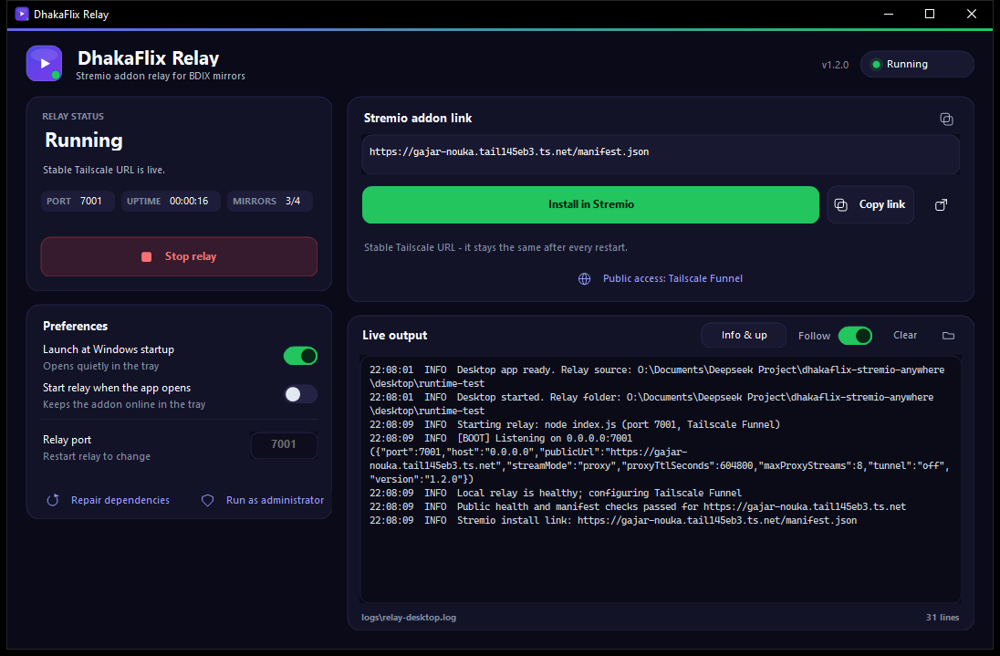

# DhakaFlix Stremio Addon

A Stremio addon for the DhakaFlix mirrors on [BDIX](https://bdix.net/) (Bangladesh),
with a built-in **public relay** so the addon can be installed and watched from
anywhere — not just from a device inside your ISP's network.

> **Fork notice**
> This repository is a fork of
> [Niloy-Sarker/dhakaflix-stremio-addon](https://github.com/Niloy-Sarker/dhakaflix-stremio-addon).
> The original project scrapes the BDIX mirrors and serves them locally. This fork
> keeps that scraper and adds the public relay, the Windows setup scripts, the
> Docker deployment kit and the documentation needed to run it as a server.
>
> **Want the internals?** [docs/HOW-IT-WORKS.md](docs/HOW-IT-WORKS.md) explains the
> whole path from pressing play to bytes arriving — including why a normal cloud
> host cannot work.

---

## The problem this solves

The mirrors live on private addresses (`172.16.50.7`, `.12`, `.14`, `.9`). Two
things follow from that:

1. Only a host **inside** a BDIX network can reach them.
2. The file URLs themselves point at those private addresses, so even if the
   addon were hosted in the cloud, a Stremio client outside BDIX could never
   fetch the video.

So "host it publicly" is not a plain deploy. The relay has to sit on a
BDIX-reachable host and forward the bytes. That is what this project does:

```
Stremio client (anywhere)
        │  HTTPS  /stream/...  and  /p/<signed token>
        ▼
  relay  (BDIX-reachable host, this app)
        │  HTTP
        ▼
  172.16.50.x mirrors
```

The stream URLs handed to Stremio are `https://<your-host>/p/<token>`, which
streams the file through the relay with full `Range` support, so seeking and
resume work exactly as before.

---

## Quick start (Windows — double-click)

Requires [Node.js 18+](https://nodejs.org/) (LTS). Everything else is automatic.

| Step | File | What it does |
| --- | --- | --- |
| 1 | **`setup.cmd`** | installs dependencies, downloads `cloudflared`, creates `.env` with a generated secret |
| 2 | **`start.cmd`** | starts the relay and prints your public install URL |
| 3 | **`stop.cmd`** | stops it again |

Double-click `start.cmd` once and it prints something like:

```
Relay is running (pid 4820)
  install URL : https://something-something.trycloudflare.com/manifest.json
  landing page: https://something-something.trycloudflare.com
  (install URL copied to clipboard)
```

Paste that URL into Stremio → Addons → Community on **any** device. The URL is
copied to your clipboard for you.

## Desktop app (Windows, one-click)

Prefer a window over a terminal? Download one of these from the
[Releases page](https://github.com/noobotos1690/dhakaflix-stremio-anywhere/releases/latest):

| Build | What it does |
| --- | --- |
| `DhakaFlixRelay-Setup-1.2.0.exe` | Per-user installer with Start Menu/desktop shortcuts and an uninstaller |
| `DhakaFlixRelay-Portable-1.2.0.zip` | Unzip anywhere and run `DhakaFlixRelay.exe`; no install |

Both need no administrator rights. The dashboard gives you Start/Stop, live
status, the Stremio install link, realtime logs and a launch-at-Windows-startup
toggle. On first launch it installs Node.js, the npm packages and `.env`
locally with a progress bar (admin only if the automatic Node.js download is
blocked, where it offers a winget install). The first successful start opens
Stremio so the addon can be added immediately.

### Public access: temporary or stable

The addon card has a **Public access** link with two modes:

| Mode | URL | Requirements |
| --- | --- | --- |
| **Cloudflare Quick Tunnel** | New `*.trycloudflare.com` hostname every start | `cloudflared` (installed by the app) |
| **Tailscale Funnel** | Permanent `https://<machine>.<tailnet>.ts.net` | Tailscale app installed and signed in; MagicDNS and HTTPS certificates enabled; Funnel allowed by the tailnet policy |

Tailscale mode works behind CGNAT and needs no port forwarding. Open **Public
access → Tailscale Funnel**, click **Connect** if needed, then **Enable Funnel**.
The app starts the relay, enables only its own port-443 Funnel listener, verifies
`/health` and `/manifest.json` over HTTPS, and shows the stable manifest URL.
The URL survives relay and Windows restarts while the app keeps running.

Two limits are explicit: Funnel hostnames only use Tailscale's `ts.net` domain,
so a custom domain such as `dhakaflix.dpdns.org` is **not** attached to it; and
Tailscale applies bandwidth limits to sustained video streaming, so playback
performance may vary.

Closing the window keeps the relay running in the tray; the app is only
terminated from the tray icon. In Cloudflare mode, exiting reminds you to remove
the addon from Stremio because the quick-tunnel URL changes; Tailscale mode
keeps the same URL.



Build it with `.\desktop\build.ps1` (needs the .NET SDK, .NET Framework 4.8
reference assemblies and Inno Setup 6); it also produces the portable zip.
Details, file locations and troubleshooting: [desktop/README.md](desktop/README.md).

## Quick start (local / any OS)

```bash
npm install
npm start
```

```
local      http://127.0.0.1:7001
install    http://127.0.0.1:7001/manifest.json
landing    http://127.0.0.1:7001/
health     http://127.0.0.1:7001/health
```

Open the landing page and press **Install in Stremio**, or paste the manifest
URL into Stremio → Addons → Community.

## The scripts

All wrappers are thin PowerShell entry points; run them directly if you prefer.

| Command | Purpose |
| --- | --- |
| `setup.cmd` | one-time setup (idempotent — safe to re-run) |
| `start.cmd` | run in the foreground; `Ctrl+C` stops it |
| `start.cmd -Background` | run detached, logs to `logs\relay.log` |
| `start.cmd -Open` | also open the install page in your browser |
| `stop.cmd` | stop the relay and its tunnel |
| `push.cmd` | commit and push to your GitHub fork |
| `scripts\autostart.ps1 -Install` | start the relay automatically at Windows login |
| `scripts\autostart.ps1 -Status` | check whether autostart is registered |
| `scripts\autostart.ps1 -Uninstall` | remove the autostart task |
| `npm run smoke` | end-to-end self-test against a running relay |

If PowerShell blocks the scripts, the `.cmd` files already pass
`-ExecutionPolicy Bypass`, so double-clicking works without changing system
settings.

## Public install (temporary URL)

Cloudflare quick tunnel, no account or domain needed:

```bash
npm run tunnel:install   # downloads cloudflared into ./tools
npm run public           # prints a https://<random>.trycloudflare.com URL
```

Use the printed `install` URL on any device. The hostname changes every time you
restart, so treat this as a trial mode.

## Public install (stable hostname)

For an addon you install once and keep, you need a hostname you control. Two
options, both supported:

### Option A — named Cloudflare tunnel on a BDIX machine

Any always-on machine inside a BDIX network (your PC, a home server, a BDIX VPS)
works.

```bash
cloudflared tunnel login
cloudflared tunnel create dhakaflix
cloudflared tunnel route dns dhakaflix flix.example.com
cloudflared tunnel token dhakaflix      # copy this token
```

```bash
PUBLIC_URL=https://flix.example.com TUNNEL_TOKEN=<token> npm start
```

### Option B — Docker on a BDIX-peered VPS

```bash
cp .env.example .env      # set PROXY_SECRET and PUBLIC_URL
docker compose up -d                              # relay on :7001
docker compose --profile tunnel up -d             # + stable tunnel
```

> A regular cloud VPS (Fly, Render, Railway, Hetzner…) will **not** work: it
> cannot route to `172.16.50.0/24`, so searches return nothing and playback
> fails. The host must be on a network that reaches the mirrors.


### Option C — Tailscale Funnel (no domain, desktop app)

The Windows desktop app can publish the relay through Tailscale Funnel:

- No public IPv4/IPv6 and no router port forwarding; works behind CGNAT.
- The URL is stable: `https://<machine>.<tailnet>.ts.net/manifest.json`.
- Requires Tailscale installed and signed in, MagicDNS, HTTPS certificates and
  Funnel allowed by the tailnet policy.
- Only `ts.net` hostnames are available; a custom domain such as
  `dhakaflix.dpdns.org` is not attached to Funnel. Tailscale also limits
  sustained video bandwidth.

Open **Public access → Tailscale Funnel** in the dashboard, click **Connect** if
needed, then **Enable Funnel**. See
[desktop/README.md](desktop/README.md#tailscale-funnel) for the GUI flow and
troubleshooting.

---

## Configuration

Everything is environment-driven; see [.env.example](.env.example).

| Variable | Default | Purpose |
| --- | --- | --- |
| `PORT` | `7001` | Listen port |
| `HOST` | `0.0.0.0` | Listen address |
| `PUBLIC_URL` | *derived from request* | Public origin used for install and stream links |
| `STREAM_MODE` | `proxy` | `proxy` (works anywhere), `direct` (BDIX clients only), `both` |
| `PROXY_SECRET` | random per boot | HMAC key for relay links — **set this in production** |
| `PROXY_TTL` | `604800` | Relay link lifetime in seconds (7 days) |
| `MAX_PROXY_STREAMS` | `8` | Concurrent relayed playback sessions |
| `TUNNEL` | `0` | `1` starts a quick tunnel |
| `TUNNEL_TOKEN` | – | Starts a named tunnel |
| `LOG_LEVEL` | `info` | `error`, `warn`, `info`, `debug` |

`STREAM_MODE=both` is handy if you watch sometimes on BDIX and sometimes away:
the relayed stream is listed first, the direct BDIX address second.

## Endpoints

| Path | Purpose |
| --- | --- |
| `GET /manifest.json` | Stremio manifest (install URL) |
| `GET /stream/:type/:id.json` | Stream resolution |
| `GET /meta/:type/:id.json` | Episode/movie metadata |
| `GET /p/:token` | Signed streaming relay (Range/HEAD supported) |
| `GET /` | Install landing page |
| `GET /health` | Uptime + per-mirror reachability |

## How it works

- **Signed relay tokens** — `/p/<token>` carries the upstream URL plus an
  expiry and an HMAC. Tokens cannot be edited into an open proxy, and targets
  are additionally restricted to the provider origins, so the relay cannot be
  used to fetch arbitrary hosts (no SSRF).
- **Range passthrough** — `Range`/`Content-Range`/`Accept-Ranges` are forwarded
  verbatim, so players can seek without downloading from the start.
- **Mirror health** — mirrors are TCP-probed at boot and every 5 minutes. A dead
  mirror (`.9` is frequently down) is skipped for 5 minutes instead of costing
  every search its full timeout. This took a cold metadata request from ~26s
  to ~3.5s.
- **Caching** — search results 12h, streams 24h, in memory.
- **Origin rewriting** — stream URLs are emitted relative and made absolute
  per request from the actual `Host`/`X-Forwarded-*` headers, so the same code
  works on localhost, a tunnel URL, or your own domain with no reconfiguration.

## Verifying a deployment

```bash
npm run smoke                                   # local
BASE_URL=https://flix.example.com npm run smoke # public
```

Checks the manifest, mirror reachability, stream resolution, a ranged relay
read, a mid-file seek, and that forged tokens are rejected.

## Security notes

- The relay is public by design: anyone with the manifest URL can use it. Keep
  `MAX_PROXY_STREAMS` modest — a home upload link saturates quickly.
- Set `PROXY_SECRET`. Without it a new secret is generated at boot and all
  previously issued stream links stop working.
- Relay links are bearer tokens for a single file until they expire; rotate
  `PROXY_SECRET` to invalidate every outstanding link.
- This project indexes and relays third-party mirrors. Only stream content you
  are entitled to access.

## Troubleshooting

| Symptom | Cause / fix |
| --- | --- |
| Streams play, no video | Host cannot reach `172.16.50.x`. Check `/health`. |
| `cloudflared not found` | Run `npm run tunnel:install` or set `CLOUDFLARED_PATH`. |
| Addon installs but shows nothing | Titles must exist on a reachable mirror; try a popular one. |
| Seek restarts from zero | A proxy stripped `Range` — the relay itself passes it through. |
| Links broke after restart | `PROXY_SECRET` unset; set it to keep tokens stable. |

## Project layout

```
setup.cmd / start.cmd / stop.cmd    double-click entry points (Windows)
push.cmd                            commit + push to your GitHub fork
index.js              entry point: server + optional tunnel
server.js             addon handlers (search / load / meta / stream)
addon.json            Stremio manifest
src/config.js         environment configuration
src/load-env.js       reads .env for plain `npm start`
src/providers.js      BDIX mirror table + proxy allow-list
src/health.js         mirror probing and circuit breaker
src/proxy.js          signed streaming relay
src/public-server.js  HTTP composition: addon + relay + landing + health
src/landing.js        install page
src/tunnel.js         cloudflared quick/named tunnel
scripts/setup.ps1     first-time setup
scripts/start.ps1     start (foreground or -Background)
scripts/stop.ps1      stop relay + tunnel
scripts/autostart.ps1 run at Windows login
scripts/push-to-github.ps1  fork remotes + push
scripts/fetch-cloudflared.js  download the tunnel binary
scripts/smoke.js      end-to-end self-test
docs/HOW-IT-WORKS.md  architecture walkthrough
Dockerfile            production image
docker-compose.yml    relay + optional tunnel sidecar
```

## Pushing your own copy to GitHub

This project is a fork, so GitHub shows the lineage only if you fork it on the
website first:

1. Fork it: <https://github.com/Niloy-Sarker/dhakaflix-stremio-addon/fork>
2. Run **`push.cmd`** (or `scripts\push-to-github.ps1`)

The script renames the upstream remote to `upstream`, points `origin` at your
fork, commits any pending work and pushes. The first run opens a browser window
so you can sign in to GitHub — after that the credential is cached and later
pushes need no interaction.

```
origin   https://github.com/<you>/<your-fork>.git                (your fork)
upstream https://github.com/Niloy-Sarker/dhakaflix-stremio-addon.git
```

Pull improvements from the original project with:

```bash
git fetch upstream
git merge upstream/main
```

## Development

The setup scripts install production dependencies only. For `npm run dev`
(nodemon auto-restart) or the full test tooling:

```bash
npm install          # includes devDependencies
npm run dev
```

## Notes

- The previous `localtunnel` helper (`index-tunnel.js`) has been removed in favour
  of `cloudflared`, which gives HTTPS, better reliability and a path to a stable
  hostname.
- `pkg` was dropped from `devDependencies`; it was only used for one-off binary
  builds and is easy to add back if you want a standalone `.exe`.
- `tools/`, `logs/`, `.run/` and `.env` are gitignored — never commit your relay
  secret or the 55 MB tunnel binary.
