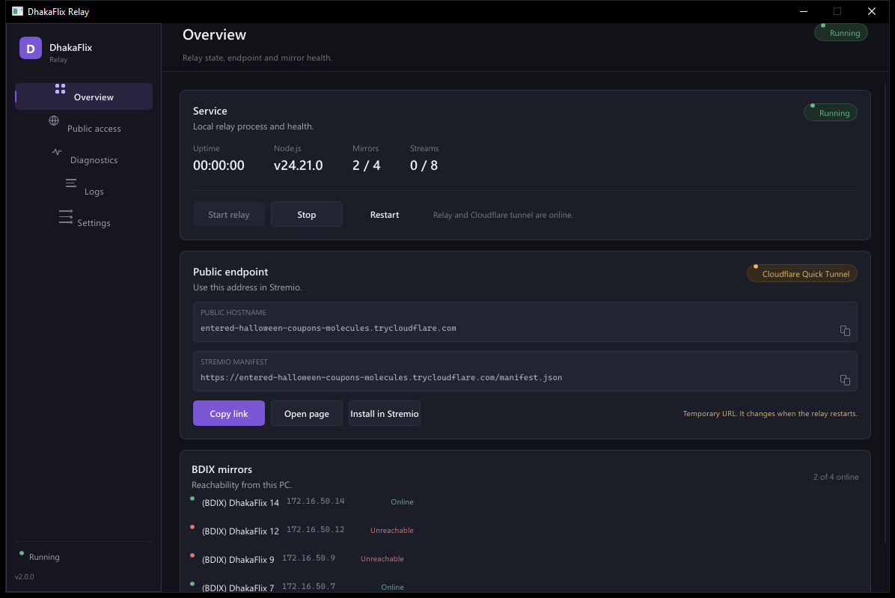

# DhakaFlix Relay — native desktop

Rust + Slint dashboard for the existing Node.js DhakaFlix relay. The relay,
scraper, proxy, Range handling, signed links and public-access transports are
unchanged. This app replaces the WinForms shell.



## What it does

- Starts, stops and restarts the local Node relay.
- Shows relay health, uptime, Node version, mirror reachability and stream counts.
- Publishes through **Cloudflare Quick Tunnel** or **Tailscale Funnel**.
- Keeps the Tailscale `ts.net` URL stable across restarts.
- Shows a filterable, searchable log with secrets and signed stream paths redacted.
- Runs from the system tray. Closing the window keeps the relay online.
- Starts with Windows when enabled in Settings.
- Reads the existing `%APPDATA%\DhakaFlix Relay\settings.json` and the existing
  `.env`, so an upgrade does not need a new account or a new `PROXY_SECRET`.

## Run

**Portable:** unzip and run `DhakaFlixRelay.exe`.

**Installed:** run `DhakaFlixRelay-Setup-2.0.0.exe`. Installation is per-user;
no administrator rights are requested.

On first start the app installs Node.js into `runtime\node`, installs npm
dependencies into `node_modules`, creates `.env` if needed, and downloads
`cloudflared` only when Cloudflare mode is selected.

## Public access

### Cloudflare Quick Tunnel

Temporary `https://<random>.trycloudflare.com` URL. It changes on every relay
start. No Cloudflare account is used.

### Tailscale Funnel

Requires Tailscale installed, signed in, MagicDNS and HTTPS certificates
enabled, and Funnel allowed by the tailnet policy. The app detects the CLI and
service, opens browser sign-in when needed, enables only its own port-443
listener, verifies local and public health plus the manifest, and stores the
mode. It does not disconnect Tailscale or reset unrelated Funnel listeners.

Tailscale Funnel provides a `ts.net` hostname only. A custom domain such as
`dhakaflix.dpdns.org` cannot be attached to Funnel.

## Settings and migration

The app writes the same PascalCase settings file as the C# build. Unknown
preferences from the old app are ignored safely; the fields that matter are
preserved. `.env` edits are line-based and backed up as `.env.bak-<timestamp>`.
`PROXY_SECRET` is never rewritten by a settings change.

To migrate:

1. Close the old app (tray → Exit).
2. Install or run the Rust build over the same app folder.
3. Check Settings → relay port, provider and startup options.
4. Start the relay. The old `.env` is reused.

The legacy C# project remains in `desktop/` for rollback until parity is
confirmed.

## Build

Requirements: Rust stable with the MSVC target, Inno Setup 6 for the installer.

```powershell
cd desktop-rust
cargo check
cargo test
cargo build --release
.\build.ps1 -SkipBuild
```

Artifacts:

- `desktop-rust\dist\DhakaFlixRelay-Setup-2.0.0.exe`
- `desktop-rust\dist\DhakaFlixRelay-Portable-2.0.0.zip`

## Architecture

| Path | Role |
|---|---|
| `ui/main-window.slint` | Window, navigation, five pages |
| `ui/components.slint` | Buttons, badges, fields, rows, provider cards |
| `ui/theme.slint` | Semantic colour and typography tokens |
| `src/relay.rs` | Node process, port checks, local health, tunnel lifecycle |
| `src/tailscale.rs` | CLI discovery, status/funnel JSON, sign-in, Funnel |
| `src/dependencies.rs` | Node/npm/cloudflared setup and portable Node download |
| `src/settings.rs`, `src/envfile.rs` | Migration-safe preferences and `.env` writes |
| `src/health.rs` | Local and public health polling |
| `src/tray.rs` | Win32 notification-area icon and menu |
| `src/startup.rs` | HKCU Run entry |
| `src/logging.rs` | Redaction, ring buffer, file log |

The Rust app does **not** reimplement the addon or streaming proxy. It launches
the existing Node entry point and supervises it.

## Tests run

- `cargo test`: 10 unit tests pass (settings migration, Tailscale/funnel JSON,
  signed-path and secret redaction, `.env` preservation, URL parsing).
- `cargo build --release`: pass.
- Live tailnet: existing `gajar-nouka.tail145eb3.ts.net` detected, Funnel target
  `http://127.0.0.1:7001`, local `/health` 200, public `/health` and
  `/manifest.json` 200.
- Cloudflare mode: temporary `trycloudflare.com` URL generated and manifest
  served.
- Start, stop and restart verified from the UI; Node exits on Stop and a new PID
  appears on Restart.
- Existing-relay detection verified against the C# app: the Rust shell adopts the
  running relay without killing it.
- Tray workflow: closing the window keeps the process alive; the Win32 tray
  `WM_COMMAND` show path restores it. No console window appears in the release
  build.
- `npm run smoke`: all 10 backend checks pass against a Rust-supervised relay
  (health, 3/4 mirrors, manifest, stream resolution, Range 206, seek, 403).
- Installer: silent per-user install to a test directory exited 0, the installed
  window opened, and the uninstaller removed it. Portable ZIP extracted with
  `DhakaFlixRelay.exe`, `index.js` and runtime source present.

## Release artifacts

| File | SHA-256 |
|---|---|
| `DhakaFlixRelay-Setup-2.0.0.exe` | `A7BDDDD8B86C87B35BD4E6EDFE42298CF322AA496224A61915F3EEE57EC676CE` |
| `DhakaFlixRelay-Portable-2.0.0.zip` | `7AB5F61FCC6FD57BBE966FB16EE064825FB1137BAEBBE32DFFB5D1A03E416F81` |


## Known limits

- The app was tested on one Windows 10 x64 machine with an existing Node.js,
  Tailscale and cloudflared setup. The portable Node download path is implemented
  but was not exercised by removing Node from this machine.
- Browser sign-in was not re-run because Tailscale was already authenticated; the
  wait/open-URL path is implemented and the existing connection path was tested.
- Public **video playback** over Funnel was not tested. `/health` and
  `/manifest.json` were. Tailscale bandwidth limits apply.
- Tailscale service-stopped and policy-denied states are mapped and unit-tested;
  the live service was not stopped during testing.
- A full Windows reboot was not performed; app restart with saved mode was.
- The app is unsigned. SmartScreen may warn on first launch.
- Dark native title bar depends on Windows 10/11 DWM support.

## Licensing

The DhakaFlix source remains MIT. The UI uses [Slint](https://slint.dev/) under
the Slint Royalty-free 2.0 licence. See `THIRD_PARTY_NOTICES.md` for attribution.
