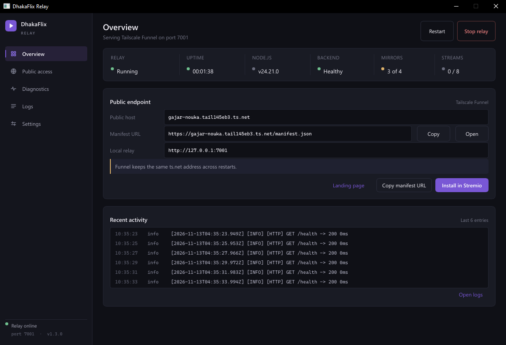

# DhakaFlix Relay - Rust desktop app

The Windows dashboard for the DhakaFlix Stremio relay, rewritten as a native
Rust application with a Slint interface. The Node.js relay, BDIX providers, the
Stremio addon API and the streaming proxy are unchanged; this app starts and
supervises that same backend.



## What it does

- Start, stop and restart the relay, with uptime, backend health, mirror count
  and active stream count read from the relay's `/health`.
- Public access in two modes: Cloudflare Quick Tunnel (`*.trycloudflare.com`,
  temporary) and Tailscale Funnel (permanent `ts.net` URL, works behind CGNAT).
  The manifest URL always comes from the live relay, never from a constant.
- Diagnostics for Node, npm packages, cloudflared, Tailscale, Funnel, local and
  public health, and per-mirror reachability.
- Log viewer with level filter, search, follow, clear and copy. Credentials,
  auth keys and signed `/p/<token>` paths are masked before they reach the UI.
- Settings for startup, auto-start, tray behaviour, default provider, port,
  maximum streams and log level, plus dependency repair and a preference reset.

Closing the window hides it to the notification area. Only **Exit** from the
tray stops the relay.

## Requirements

- 64-bit Windows 10 or 11.
- No .NET, no WebView2, no Electron, no administrator rights.
- Node.js 18+ if it is already installed; otherwise the app downloads a private
  runtime into its own folder on first run. Packaged builds already contain one,
  so nothing is downloaded.

## Install

Three builds, all per-user:

| Build | Use it when |
| --- | --- |
| `DhakaFlixRelay-Setup-1.3.0.exe` | You want Start Menu/desktop shortcuts and an uninstaller |
| `DhakaFlixRelay-Portable-1.3.0.exe` | You want one file that unpacks itself into a folder you pick |
| `DhakaFlixRelay-Portable-1.3.0.zip` | You want an unpacked folder to copy to a USB drive |

The binaries are unsigned, so SmartScreen may show *Windows protected your PC*:
choose **More info → Run anyway**.

All three builds carry the same payload: the app, `runtime\node` (Node.js and
npm), `node_modules` (the relay's packages) and `tools\cloudflared.exe`. A
freshly unpacked copy runs offline on a machine with no Node installation.
Only Tailscale stays external, and only in Funnel mode.

### First run

A new folder has no `.env`. The first start writes one from `.env.example` with
a fresh random `PROXY_SECRET` (32 bytes as hex), registers it for log redaction
and starts the relay with it, so stream links still work after a restart.

The file is only created when it is missing. An existing `.env` is never
rewritten on startup, even when its secret is incomplete, so hand-edited keys
survive. Delete `.env` to rotate the secret.

**Repair dependencies** in Settings is a re-check, not a required setup step: it
verifies Node, the npm packages, cloudflared and `.env`, installs anything
actually missing, and regenerates `PROXY_SECRET` when the file has none. On a
packaged build it normally reports everything ready without downloading.

## Build

Requirements: Rust stable with the `x86_64-pc-windows-msvc` toolchain, and
[Inno Setup 6](https://jrsoftware.org/isinfo.php) for the installer.

```powershell
cd desktop-rust
cargo check
cargo test
cargo build --release        # target\release\DhakaFlixRelay.exe
.\build.ps1                  # app + installer + portable exe + portable zip
.\build.ps1 -SkipInstaller   # app + portable zip only (needs no Inno Setup)
```

Artifacts land in `desktop-rust\dist`:

```
dist\app\DhakaFlixRelay.exe                     staged payload
dist\DhakaFlixRelay-Setup-1.3.0.exe             per-user installer
dist\DhakaFlixRelay-Portable-1.3.0.exe          single-file portable extractor
dist\DhakaFlixRelay-Portable-1.3.0.zip          portable folder
```

`build.ps1` stages the relay source and bundles the runtime next to the exe:
`runtime\node` (Node.js plus npm from the build machine), `node_modules` (the
relay's packages) and `tools\cloudflared.exe`. It fails rather than shipping a
partial payload if Node 18+ or `node_modules` is missing on the build machine.

## Design tokens

All colours, type sizes, radii and spacing live in `ui/theme.slint`. The palette
is a dark Material-style surface stack with one purple accent:

| Token | Value | Use |
| --- | --- | --- |
| `Theme.bg` | `#111218` | Window background |
| `Theme.sidebar` | `#151620` | Navigation rail |
| `Theme.surface` | `#1B1D29` | Panels |
| `Theme.raised` | `#292B3B` | Hover, inputs, selected row |
| `Theme.accent` | `#7957D5` | Primary action, active navigation |
| `Theme.text` | `#F3F1F8` | Headings, values |
| `Theme.text-2` | `#A5A5B5` | Labels |
| `Theme.text-3` | `#77798B` | Hints, metadata |
| `Theme.border` | `#303242` | Thin separators and focus rings |
| `Theme.ok / warn / error` | `#69B68B` / `#E2B66B` / `#E17676` | Status only |

Accent colour marks interactivity and the current page. Status colours appear
next to the state they describe and nowhere else.

## Project layout

```
desktop-rust/
  Cargo.toml, build.rs        crate manifest, Slint compilation, icon embedding
  ui/theme.slint              design tokens
  ui/components.slint         buttons, nav item, panel, metric, log list, dialogs
  ui/main-window.slint        shell: rail, page switching, toast, confirmation
  ui/tray.slint               native tray icon and menu
  ui/pages/*.slint            overview, public access, diagnostics, logs, settings
  src/main.rs                 entry point, single instance, activation listener
  src/app.rs                  UI state, rendering, diagnostics rows, toasts
  src/controller.rs           callback wiring, relay lifecycle, background loops
  src/relay.rs                node process, output capture, health probes
  src/health.rs               /health parsing, mirror summary, manifest URLs
  src/stremio.rs              deep links, Stremio discovery, clipboard
  src/tailscale.rs            exe discovery, status/funnel JSON, funnel commands
  src/deps.rs                 Node/npm/cloudflared/.env detection and install
  src/settings.rs             %APPDATA%\DhakaFlix Relay\settings.json
  src/envfile.rs              line-preserving .env editor with backups
  src/startup.rs              HKCU Run entry
  src/logging.rs              in-memory log hub, file log, redaction
  src/http.rs                 WinHTTP GET and download
  src/winutil.rs              process tree stop, ports, mutex, ShellExecute
  installer.iss, build.ps1    packaging
  make-assets.ps1             draws app.ico, icon.png and tray.png
```

### Dependencies

`slint` 1.18 (winit backend, femtovg renderer, system tray), `slint-build`,
`tokio`, `serde`/`serde_json`, `tracing`/`tracing-subscriber`, `chrono`,
`windows-sys` (WinHTTP, registry, threading, shell, BCrypt), `winres` for the
icon. No TLS stack: HTTPS goes through WinHTTP, so the binary has no OpenSSL
dependency and no extra runtime files.

Process management uses `taskkill /PID <pid> /T` and escalates to `/F` after
three seconds, because a console node process on Windows has no portable
graceful signal.

### Relay adoption

If the configured port is already in use, the app asks `/health` who is
listening:

- a DhakaFlix relay → adopted as **Running (external)**; stop and restart are
  disabled, the log says so, and the app never kills it;
- anything else → reported as a port conflict with the owning process name.

No untrusted PID is ever terminated.

## Upgrading from 1.2.0

The app reads and writes the same state as the 1.2.0 build, so an upgrade needs
no export:

- `%APPDATA%\DhakaFlix Relay\settings.json` keeps its PascalCase keys. New keys
  (`MaxStreams`, `LogLevel`, `MinimizeToTray`) are added on first save; unknown
  keys written by the C# build are preserved.
- `.env` is edited line by line with `.env.bak-<timestamp>` backups.
  `PROXY_SECRET` and unrelated keys are never touched.
- The startup entry keeps the same value name (`DhakaFlix Relay`) and argument
  (`--autostart`), so no duplicate Run entry appears.
- The log file stays at `logs\relay-desktop.log`.
- Tailscale sign-in is a property of the Tailscale device, not of this app, so
  an existing Funnel setup is detected and reused.

The 1.2.0 C# build is no longer in the repository. Its sources are in the
`v1.2.0` tag, and the installer and portable zip are still on that release. To
roll back, uninstall this build and install
`DhakaFlixRelay-Setup-1.2.0.exe` from the v1.2.0 release; nothing in `%APPDATA%`
or `.env` has to be restored because both builds share the same format.

Both installers use the same AppId and the same `Local\DhakaFlixRelay.Desktop`
mutex, so they replace each other rather than stacking up.

## Tests

```powershell
cargo test     # 17 unit tests: .env creation and editing, URL splitting, health
               # payloads, Tailscale status/funnel fixtures, relay output parsing,
               # redaction, crash logging
npm run smoke  # from the repo root; exercises the Node relay
```

The Tailscale tests parse the real CLI JSON samples in
`desktop\tests\fixtures`, so no Tailscale account is needed.

## If it closes unexpectedly

Every unexpected error is written to `%APPDATA%\DhakaFlix Relay\crash.log`
with a backtrace, and to `logs\relay-desktop.log` next to the exe. Startup
failures (no window runtime, tray icon refused, interface stopped) show a
dialog with the reason instead of exiting quietly.

Closing the window leaves the app in the notification area; launching it again
raises that same window rather than starting a second relay. If a launch seems
to do nothing, look for the tray icon.

## Limitations

- Live Tailscale Funnel and public streaming were not exercised from this build
  environment; the parsing and command paths are covered by fixture tests.
- The binary is unsigned, so SmartScreen warns on first run.
- Stopping the relay is forceful: the console node process has no graceful
  shutdown channel, so in-flight streams are cut.
- Funnel is bandwidth-limited by Tailscale and only serves `ts.net` hostnames.
  A custom domain needs a Cloudflare named tunnel instead.

## Licence

The app uses Slint under its royalty-free licence; the required acknowledgement
is in `THIRD-PARTY-NOTICES.md` and in the Settings page footer. The repository
has no top-level licence file, so the application code follows the repository's
existing terms. Slint is also available under GPLv3; the royalty-free option
keeps this build's distribution terms unchanged.
