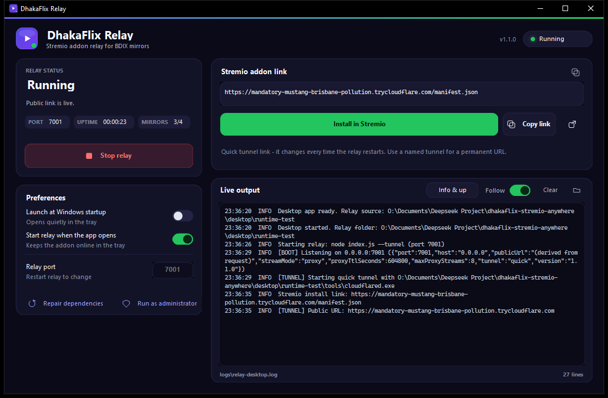
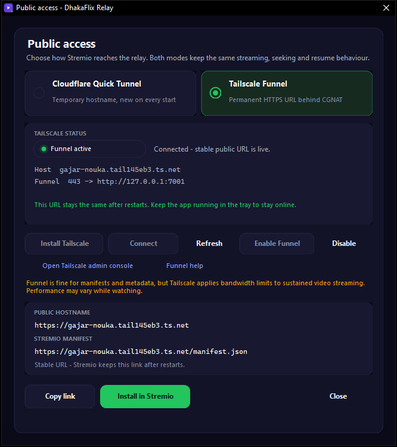
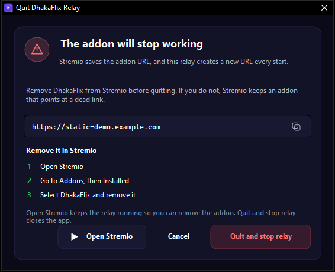

# DhakaFlix Relay — Windows desktop app

A small dashboard for the DhakaFlix Stremio relay. It replaces the
`setup.cmd` / `start.cmd` / `stop.cmd` dance with one window:

- **Start / stop** the relay with one button.
- **Live status**: starting, running, stopped or needs attention, with uptime
  and how many BDIX mirrors are reachable.
- **Stremio install link**, ready to copy or install with one click.
- **Realtime logs** straight from the relay process, colour-coded and written to
  a log file.
- **Launch at Windows startup** (per-user, no admin needed).
- **Dependency setup** on first run: Node.js runtime, npm packages, cloudflared
  and `.env` are detected and installed locally.
- **Runs in the tray**: closing the window keeps the relay online. The app is
  only terminated from the tray icon.
- **First run opens Stremio** so the addon can be added immediately.
- **Two public access modes**: Cloudflare Quick Tunnel (temporary) or
  Tailscale Funnel (permanent `ts.net` URL, works behind CGNAT).
- **Quit warning** in Cloudflare mode: before the relay exits the app reminds
  you to remove the addon, because the quick-tunnel URL changes on every start.



## Download

Two builds are published on the
[Releases page](https://github.com/noobotos1690/dhakaflix-stremio-anywhere/releases/latest):

| Build | Use it when |
| --- | --- |
| `DhakaFlixRelay-Setup-1.2.0.exe` | You want Start Menu/desktop shortcuts and an uninstaller |
| `DhakaFlixRelay-Portable-1.2.0.zip` | You want to unzip and run without installing |

Both are per-user and need **no administrator rights**. The build is unsigned, so
SmartScreen may show *Windows protected your PC* — choose **More info → Run
anyway**.

The app needs **.NET Framework 4.8**, which ships with Windows 10 (May 2019
update and later) and Windows 11.

## Install

### Installer

1. Run `DhakaFlixRelay-Setup-1.2.0.exe`.
2. Optionally tick **desktop shortcut** and **start with Windows**.
3. Launch **DhakaFlix Relay**.

Installed to `%LOCALAPPDATA%\Programs\DhakaFlix Relay`; uninstall from
**Settings → Apps** or the Start Menu.

### Portable

1. Unzip `DhakaFlixRelay-Portable-1.2.0.zip` anywhere (Desktop, USB drive, ...).
2. Run `DhakaFlixRelay.exe`.

The portable build keeps its Node runtime, packages, logs and `.env` in the same
folder. To uninstall, turn off **Launch at Windows startup** first, exit from the
tray, then delete the folder.

## First run

The dashboard opens with a setup banner when something is missing. What it asks
for depends on the selected public access mode:

| Missing | How it is installed |
| --- | --- |
| Node.js 18+ | A private runtime is downloaded into `runtime\node` (no admin) |
| npm packages | `npm install --omit=dev` with progress in the log |
| cloudflared (Cloudflare mode) | Downloaded into `tools\cloudflared.exe` |
| `.env` | Created from `.env.example` with a generated `PROXY_SECRET` |
| Tailscale (Tailscale mode) | Not installed by the app. The banner/dialog opens the official download page; the installer may ask for administrator rights |

Click **Install dependencies** and wait for the banner to disappear. Then click
**Start relay**. On the **first successful start**, the app opens Stremio with the
addon install prompt. If Stremio is not installed, it offers the download page
instead.

## Public access

Open **Public access** at the bottom of the Stremio addon card.



### Cloudflare Quick Tunnel

- The default, backward-compatible mode.
- Starts `node index.js --tunnel`; the app detects the random
  `*.trycloudflare.com` hostname and shows the manifest URL.
- The URL changes on every start, so a Stremio install becomes stale after a
  restart. The tray Exit dialog reminds you to remove the addon first.
- Requires `cloudflared`, installed by the app on first setup.

### Tailscale Funnel

A permanent public HTTPS URL that works behind CGNAT without a public IPv4/IPv6
address or router port forwarding. The URL looks like:

```
https://<machine>.<tailnet>.ts.net/manifest.json
```

Prerequisites:

- Tailscale installed and signed in on the same PC.
- MagicDNS enabled for the tailnet.
- HTTPS certificates enabled for the tailnet.
- Funnel allowed by the tailnet access policy.

Steps in the app:

1. Open **Public access** and select **Tailscale Funnel**.
2. If Tailscale is missing, click **Install Tailscale** (opens
   `https://tailscale.com/download/windows`). The app never installs system
   networking software silently and never bypasses UAC.
3. If the status says *Not connected* / *Sign-in needed*, click **Connect**.
   `tailscale up` runs and Tailscale opens the browser for sign-in; no auth key
   is requested and no Tailscale credential is stored.
4. Click **Enable Funnel**. If the relay is not running, the app offers to start
   it first.
5. The app runs the equivalent of:

   ```
   tailscale funnel --bg --yes --https=443 http://127.0.0.1:<relay-port>
   ```

   It then verifies the local `/health`, the public `/health` and the public
   `/manifest.json` before reporting **Running**. The stable URL and manifest are
   shown; **Copy link** / **Install in Stremio** use it.
6. **Disable** removes only the Funnel listener that points at the DhakaFlix
   relay. The app never runs a global `tailscale funnel reset`, and it refuses to
   overwrite another service on port 443 without an explicit confirmation.

The selected mode, the cached hostname and the Cloudflare configuration that was
replaced are stored in `%APPDATA%\DhakaFlix Relay\settings.json`. Switching back
to Cloudflare restores `PUBLIC_URL`, `TUNNEL` and `TUNNEL_TOKEN` in `.env` from
that saved state. `.env` edits are line-based, keep comments and unrelated keys,
never touch `PROXY_SECRET`, and write a `.env.bak-<timestamp>` backup first.

### A constant, friendlier name

The `ts.net` URL is permanent, but its first label is the Tailscale device
name. To use a name like dhakaflix instead of the machine name:

1. Disable Funnel in the app (if active).
2. Open the Tailscale admin console → **Machines** → your device → **Rename**,
   for example to dhakaflix.
3. Return to Public access, click **Refresh**, then **Enable Funnel**.

The URL becomes https://dhakaflix.<tailnet>.ts.net. Renaming changes the URL,
so update the addon in Stremio afterwards.

A custom domain such as dhakaflix.dpdns.org **cannot** be attached to
Tailscale Funnel. Funnel only serves `ts.net` hostnames. A custom domain needs a
Cloudflare named tunnel with the domain delegated to Cloudflare (separate from
Tailscale mode).

### Custom domain limitation

Tailscale Funnel only publishes hostnames under the tailnet's **`ts.net`**
domain. A registered domain such as `dhakaflix.dpdns.org` (DigitalPlat DNS) is
**not** attached to Funnel. The app therefore uses the generated
`<machine>.<tailnet>.ts.net` hostname and leaves the custom DNS zone unchanged.

### Video bandwidth

Funnel is intended for small services. Tailscale applies non-configurable
bandwidth limits, so sustained video streaming through Funnel may be slower or
less stable than a direct relay. The dialog shows this warning; the app does not
attempt to bypass Tailscale's limits.

## The link changes on every start (Cloudflare mode)

The quick tunnel creates a new random hostname on every start, so an addon
installed in Stremio becomes stale when the app restarts. Quitting the app from
the tray shows a reminder:



- **Open Stremio** keeps the relay running so you can remove the addon.
- **Cancel** returns to the app.
- **Quit and stop relay** stops the relay and exits.

Remove the addon in Stremio (Addons → Installed → DhakaFlix → remove) before
confirming, otherwise Stremio keeps a dead link.

In **Tailscale mode** the URL stays the same, so the addon-removal warning is not
shown. A simple confirmation explains that the relay goes offline until the app
starts again.

## Window, tray and exit

- **X / Alt+F4** hides the window. The relay keeps running.
- A notification tells you the first time that the app is still in the tray.
- **Tray icon** menu: Open dashboard, Start relay, Stop relay, Copy Stremio link,
  Exit DhakaFlix Relay.
- **Only the tray Exit** terminates the app for user actions. It asks about
  removing the addon in Cloudflare mode, then stops the relay and closes.
- Double-clicking the tray icon, or launching the app again, brings the window
  back.
- Windows shutdown and the uninstaller may still close the app; that is required
  for updates and reboot.

## Preferences

- **Launch at Windows startup** writes a per-user `Run` entry:
  `"DhakaFlixRelay.exe" --autostart`. On login the app starts hidden in the
  notification area and starts the relay when the second toggle is on.
- **Start relay when the app opens** keeps the addon online after a restart.
- **Relay port** changes the local port (1024–65535). The change applies on the
  next start; the port is passed through the environment. In Tailscale mode the
  Funnel target is updated on the next start/Enable.
- **Repair dependencies** re-runs detection for the selected mode and fills in
  anything missing.
- **Run as administrator** restarts the app elevated (only useful for
  system-wide installs; the normal per-user install never needs it).

## Where files live

| Path | Contents |
| --- | --- |
| `%LOCALAPPDATA%\Programs\DhakaFlix Relay\` | App, relay source, `node_modules`, `tools`, `runtime`, `.env` |
| `...\logs\relay-desktop.log` | Everything shown in Live output (5 MB rotation) |
| `%APPDATA%\DhakaFlix Relay\settings.json` | Mode, cached Tailscale host, port, startup toggles, log filter, first-run flag |
| `%APPDATA%\DhakaFlix Relay\crash.log` | Only written if the app hits an unexpected error |
| `...\.env.bak-<timestamp>` | Backup written before each `.env` change |

The relay folder is writable, which is why dependency setup does not need admin.

## Logs

Live output shows the relay's own lines (`[BOOT]`, `[TUNNEL]`, `[HTTP]`, …) plus
app and Tailscale messages. Use the level button to switch between *All output*,
*Info & up*, *Warnings* and *Errors*. **Follow** keeps the newest line in view;
**Clear** only clears the view; the log file keeps everything. The folder button
opens the log folder.

## Build from source

Requirements on the build machine:

- Windows with .NET Framework 4.8 **reference assemblies**
- .NET SDK (for the Roslyn compiler)
- [Inno Setup 6](https://jrsoftware.org/isinfo.php) for the installer
- Windows PowerShell 5.1 (for icon/artwork generation)

```powershell
.\desktop\build.ps1              # app + installer + portable zip
.\desktop\build.ps1 -SkipInstaller
.\desktop\build.ps1 -ForceIcon   # redraw icon and wizard artwork
.\desktop\tests\run-tests.ps1    # Tailscale parsing + .env tests (no account needed)
```

Output:

```
desktop\dist\app\DhakaFlixRelay.exe
desktop\dist\DhakaFlixRelay-Setup-1.2.0.exe
desktop\dist\DhakaFlixRelay-Portable-1.2.0.zip
```

`build.ps1` compiles `desktop\src\*.cs` against the in-box .NET Framework 4.8
assemblies, stages the relay source next to the exe, draws the icon and Inno
artwork, builds the installer, then zips the staged folder for the portable
build. The app deliberately has no NuGet or Electron dependencies: the exe is
~200 KB and runs on a stock Windows 10/11 machine.

## Project layout

```
desktop/
  src/Program.cs              entry point, single instance, crash reporting
  src/MainForm.cs             window, layout, setup, logs, tray, exit, mode switching
  src/PublicAccessDialog.cs   Cloudflare/Tailscale selection, status and actions
  src/TailscaleManager.cs     tailscale.exe detection, status/funnel JSON, connect, enable/disable
  src/PublicAccess.cs         access-mode enum and storage names
  src/EnvFileEditor.cs        comment-preserving .env updates with backups
  src/QuitDialog.cs           "remove the addon before quitting" reminder
  src/RelayController.cs      spawns node, local/public health checks, job object
  src/DependencyManager.cs    mode-aware Node/npm/cloudflared/.env detection
  src/StremioHelper.cs        finds/opens the Stremio app and install links
  src/StartupManager.cs       HKCU Run key
  src/AppPaths.cs             install locations
  src/Settings.cs             %APPDATA% preferences (mode, cached host, backups)
  src/Theme.cs, Ui.cs         palette, vector icons, custom controls
  app.manifest, app.config    per-monitor DPI, dark title bar, asInvoker
  installer.iss               Inno Setup definition (per-user install)
  build.ps1                   icon + artwork + compile + installer + portable zip
  tests/run-tests.ps1         fixture-based parser/env tests
  tests/fixtures/*.json       real-schema Tailscale status/funnel samples
```

The relay itself is unchanged. In Cloudflare mode the dashboard runs
`node index.js --tunnel`; in Tailscale mode it runs `node index.js` with
`PUBLIC_URL=https://<host>`, `TUNNEL=0`, `TUNNEL_TOKEN` cleared, and verifies the
public endpoints before reporting Running. Stopping uses a Windows job object so
`cloudflared` cannot be left behind.

## Troubleshooting

| Symptom | Fix |
| --- | --- |
| "Node.js could not be prepared" | Allow the winget install when prompted, or install Node.js 18+ from nodejs.org, then **Repair dependencies**. |
| Port 7001 already in use | Stop the other process (or the CLI relay), or change **Relay port**. |
| Window vanished | It is in the notification area — double-click the tray icon. Exit is there too. |
| Tailscale: "Not installed" | Install from the dialog's **Install Tailscale** button, sign in, then **Refresh**. |
| Tailscale: "Service stopped" | Start the Tailscale app/service, then **Refresh**. The app does not restart system services. |
| Tailscale: "Sign-in needed" | Click **Connect**, finish the browser sign-in, and wait; the dialog polls until connected. |
| Funnel policy/HTTPS error | Enable Funnel, MagicDNS and HTTPS certificates in the Tailscale admin console (the dialog opens it), then retry. |
| Funnel conflict on 443 | Port 443 already serves another target. The dialog shows it and asks before replacing; review the admin console first. |
| Stable URL gives 502 | The relay is stopped or the PC is asleep. Start the relay; the URL stays the same. |
| Cloudflare public link never appears | Check the log for `[TUNNEL]`; GitHub/Cloudflare may be blocked. The app falls back to the local link. |
| Stremio shows no streams | The relay host must be able to reach the BDIX mirrors (172.16.50.x). This is an ISP-side requirement, not an app setting. |
| Installing an update says files are in use | Exit from the tray first, then run the installer again. |
| Installer says .NET 4.8 missing | Install the .NET Framework 4.8 runtime, then run setup again. |

## Uninstall

- **Installer build**: Settings → Apps → DhakaFlix Relay → Uninstall, or the
  Start Menu uninstaller. Downloaded `node_modules`, `runtime`, `tools`, logs and
  `.env` are removed with the app.
- **Portable build**: turn off startup, exit from the tray, delete the folder.

Settings in `%APPDATA%\DhakaFlix Relay` are kept so a reinstall remembers your
preferences; delete that folder for a clean slate. Uninstalling does **not**
remove the Tailscale app, disconnect your tailnet, or reset other Funnel
listeners.
